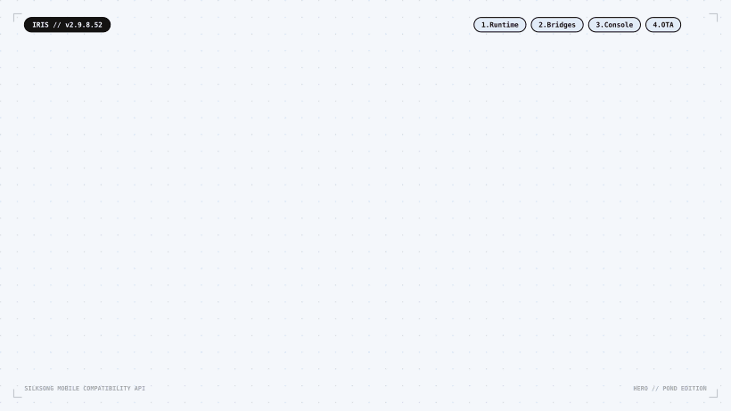
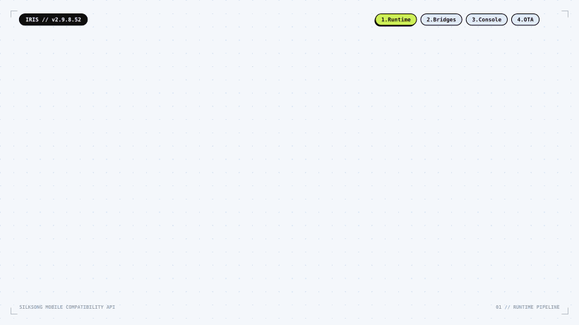
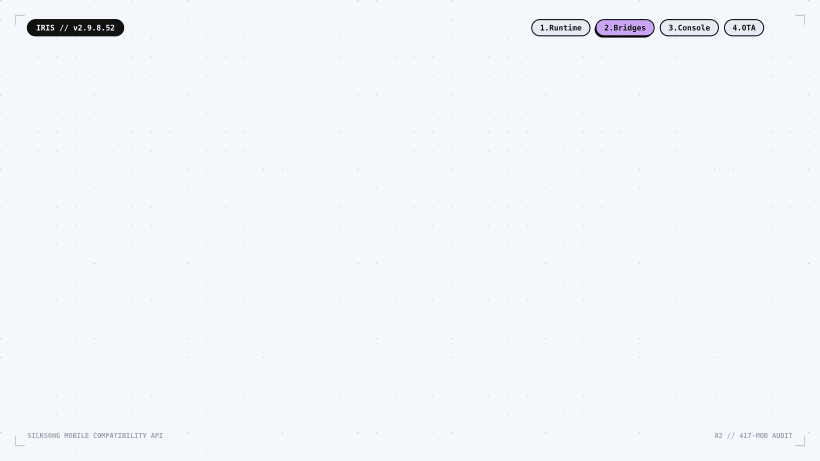
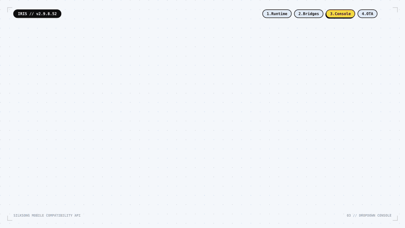
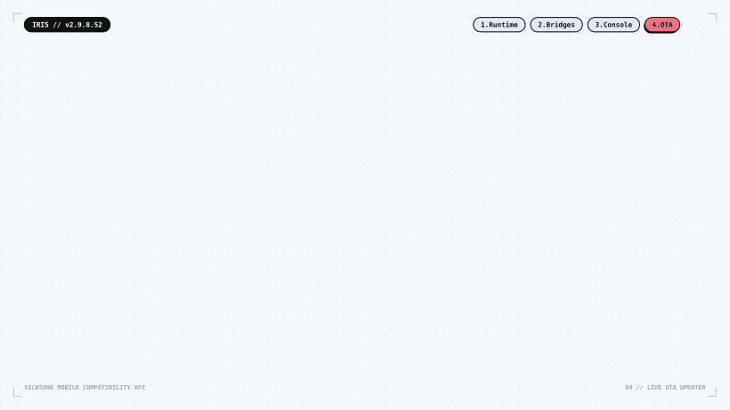

# IRIS — Silksong Mobile Modding API

[](CHANGELOG.md)
[](https://irislayer.bearblog.dev/)
[](#)
[](#)
[](LICENSE)

<p align="center">
  
</p>

On-device compatibility layer for running PC BepInEx, Harmony, and MonoMod mods on *Hollow Knight: Silksong* Android (`com.game.silksong`) without separate mobile forks.

---

## 1. Runtime Architecture

<p align="center">
  
</p>

- **Runtime Bytecode Rewriter (`CecilCore`)**: Rewrites PC mod DLLs on-device (BCL redirects, overload/struct field bridges, IL2CPP guards) with automatic wildcard disk caching (`.cecil_cache_v29852`).
- **AOT-Safe Harmony & MonoMod Bridge**: Maps desktop patches to 480 precompiled JIT-free HybridCLR hook slots and Dobby native detours.

## 2. Compatibility Bridges (417 Mods Audited)

<p align="center">
  
</p>

- **.NET Standard 2.1 & Unity 6 Shims**: Bridges missing Android `mscorlib` / Unity APIs (`String` overloads, `Enum.Parse<TEnum>`, `Enum.TryParse`, `CollectionExtensions`, `MathF`, `ConditionalWeakTable.AddOrUpdate`, `Collider2D.CreateMesh`, `Rigidbody2D.linearVelocity`, `LegacyRuntime.ttf` font fallback).
- **Asset, Shader & Boss Guards**: Repairs PC shaders, bridges `AssetHelper` / `FsmUtil` / `BossKit` / `I18N`, unloads finished HK boss scenes/bundles to prevent Android OOM crashes, and includes toggleable boss/arena guards (Pale Automaton Phase 2 grounding & parry fixes, Rebellious Second Sentinel OOB rescue, Third Acolyte bridges).

## 3. Touch-First In-Game Mod Console

<p align="center">
  
</p>

- **Dropdown Accordion Mod Configs**: Mod settings collapse under clickable mod headers (`[>]` / `[v]`) so config pages stay compact and scannable on mobile screens.
- **Touch Keybinds & Profiles**: Floating mod bubble, dedicated `0–9` & `A–Z` touch key tabs with Tap/Hold toggle, Pantheon boss skip, and `iris_profile.jsonc` sync.

## 4. Live GitHub OTA Updater

<p align="center">
  
</p>

- **One-Tap In-Game Updates**: Checks `00_IRIS/plugin.json` on startup, shows a 3-second notification toast on `Menu_Title` when an update is available, displays a full-screen `UPDATING IRIS...` progress overlay during download, and validates PE (`MZ`) headers with automatic `.bak` rollback.

---

## Highlighted Tested Mods
- **Bosses & Expansions**: Godhome (`HkCore` + `HkBossLoader`), *Third Acolyte*, *Bonemaster*, *Lost & Chained*, *Pale Automaton*, *Rebellious Second Sentinel*, *Aeternal Everwatcher*, *Cousins of Void*, *Final Judge*, *Boss Rush*.
- **Mechanics & QoL**: *Needleforge*, *Benchwarp*, *MapWarp*, *Crest Wheel*, *Rebalanced Crests*, *Architect Pogo QoL*, *CustomTranslation*, *SilkGoddess*, *Tribe Tower Performance*.

## Build (Linux)
Requires [.NET SDK 8.0+](https://dotnet.microsoft.com/) and mobile reference DLLs in `~/Projects/lib/`:
```bash
bash ~/Projects/build_silksong_mobile_api.bash
```
Outputs to `~/Projects/SilksongMobileAPI/00_IRIS/`.

## Logs
```bash
adb pull /storage/emulated/0/Android/data/com.game.silksong/files/BepInEx/LogOutput.log .
adb pull /storage/emulated/0/Android/data/com.game.silksong/files/BepInEx/ModLog.log .
```

## Pending API Bugs
- [ ] P2 softlock at Mantis Lords
- [ ] Mantis Lords & Sisters of Battle not ending properly
- [x] Pantheon boss skip button (`BossFixes.EnablePantheonBossSkip`)

## License
MIT — original compatibility bridge & UI code only (no game binaries or third-party mod assets).
